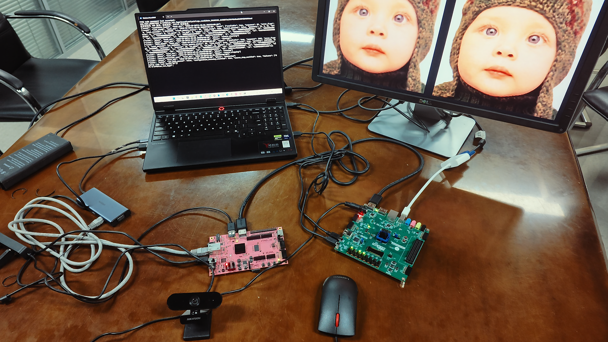
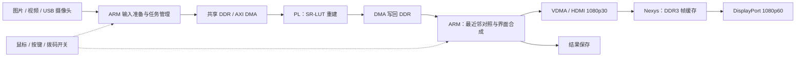

# 基于 SR-LUT 的双 FPGA 图像超分辨率系统

**查表超分 · 双板协同 · 端侧加速**

[技术报告](docs/report.pdf) · [操作手册](docs/user_guide.md) · [构建与复现](docs/reproduction.md) · [PYNQ Skill](skill/README.md) · [配套下载](https://github.com/killua365/sr-lut-fpga/releases/tag/project-20261104)



## 1. 项目摘要

低带宽视觉链路与嵌入式终端常面临输入分辨率不足、计算和存储资源受限的问题。本项目将学习得到的局部映射保存为查找表，在线通过整数寻址、五顶点插值和方向融合完成超分重建，使图像增强能够部署在 Zynq-7020 平台上。

系统采用 **PYNQ-Z2 + Nexys Video** 双板架构。PYNQ ARM 管理输入、调度硬件并合成界面，PL 执行 SR-LUT 重建；Nexys 接收 HDMI 完整界面帧，经 DDR3 缓存后向显示器输出。图片、视频和摄像头共用处理链路，提供 Compare、Wipe、ROI、逐帧观察及结果保存功能。

当前源码与部署合同对应 **r17**，包路径及校验值见 [source.json](board/release/source.json)。本仓库提供工程源码、报告、硬件产物与验证记录，大型离线依赖和原始视频数据由配套 Release 管理。

## 2. 系统架构



重建结果先返回 ARM 合成完整画面，再进入 HDMI 显示通路。**60 Hz 是显示扫描时序**；处理结果按完成节奏更新，没有新结果时重复扫描当前帧。DP 直连为主要接入方式，MiniDP 转 VGA 使用独立的已验证配置。

## 3. 核心模块与功能

| 模块 | 实现与功能 |
|---|---|
| 输入与交互 | PYNQ ARM：图片读取、视频解码、摄像头采集；管理倍率、模式、ROI 和保存任务 |
| 超分重建 | PYNQ PL：四像素邻域、四维查表、五顶点插值、四方向恢复与融合；×2 单核、×4 三同构核 |
| 画面合成 | ARM 与原生像素库：最近邻对照、Compare / Wipe、质量指标、控件与结果导出 |
| 缓存显示 | Nexys Video：HDMI 接收、DDR3 完整帧发布与缓冲回收、DisplayPort 扫描 |
| PYNQ Skill | 独立 Python 包：Overlay / DMA 调用模板、非超分算例、故障注入和检查工作流 |

| 输入 | 倍率与输出 | 交互功能 |
|---|---|---|
| 图片 | 原生 LR/HR 配对，×2 / ×4 | 切图、ROI、Fit / 1:1、PSNR-Y / SSIM-Y、PNG 保存 |
| 视频 | 480×270 输入，×2 / ×4 | 播放暂停、逐帧、速度、循环、导入和 MP4 导出 |
| 摄像头 | 480×270 → 1920×1080，固定 ×4 | Freeze / Resume、同帧快照、Compare / Wipe |

## 4. 主要指标与技术特点

| 指标 | 结果与条件 |
|---|---|
| Set5 ×2 平均质量 | q=16：PSNR-Y **35.510 dB**，SSIM-Y **0.9477**；较 OpenCV cubic 提高 **1.543 dB** |
| Set5 ×4 平均质量 | q=32：PSNR-Y **29.631 dB**，SSIM-Y **0.8425**；较 OpenCV cubic 提高 **0.998 dB** |
| ×4 单核原始 LUT | q=16 → q=32：1,336,336 → **104,976 B**，减少 **92.14%** |
| ARM 合成优化 | 历史 r10 → r11 短窗口：中位耗时 175.771 → **42.735 ms**，降低 **75.69%** |
| 显示确认新帧率 | 同一优化短窗口：12.0794 → **22.6143 fps**；优化后 20.473736 s 内确认 463 帧 |
| PYNQ ×4 完整系统 | **19,220 LUT / 18,035 FF / 113 BRAM36 等效块 / 2 DSP** |
| PYNQ ×4 实现时序 | 100 MHz 计算时钟；WNS **0.144 ns**、WHS **0.014 ns** |

质量评价采用 Set5 五组图像，评分口径见[报告第 3.3 节](docs/report.pdf)。帧率为相应历史窗口内完成的新帧计数。原始记录见[验证索引](report/validation/status.md)与 [ARM 优化证据](skill/evidence/project/render_r11_implementation.json)。

- **查表存储与多核调度联合配置**：缩减 ×4 表容量，为三个同构插值核留出片上空间；共享通道与方向任务，按序提交结果。
- **整数插值末端统一舍入**：保留有符号权重和累加结果，在四方向融合后统一舍入与饱和。
- **跨板完整帧发布与延迟回收**：分别管理 PYNQ 与 Nexys 缓冲，协调写入、等待显示、扫描及旧帧回收。
- **RGBX 整字合成与静态布局复用**：减少 ARM 逐通道操作及重复访存，提高合成效率。

## 5. 目录结构

| 路径 | 内容 |
|---|---|
| `src/` | RTL、ARM 程序、算法参考和第三方组件索引 |
| `sim/` | 仿真、软件回归和控制器测试 |
| `build/` | 构建脚本、冻结硬件产物及实现报告 |
| `board/` | 部署与运行控制、恢复依赖、发布合同 |
| `data/` | LUT、配对图像、视频和黄金数据 |
| `skill/` | 独立 PYNQ 技能包及其 README |
| `report/` | 工程设计说明、协作记录及验证证据 |
| `docs/` | 最新报告 PDF、实物图、操作与复现指南 |
| `runtime/` | 离线环境定义与板端环境记录 |
| `tools/` | 下载恢复、构建、打包与检查工具 |

工程保留两份 README：本文件和 [skill/README.md](skill/README.md)。组件的必要详细说明按主题命名；第三方压缩包内的原始说明与许可保留。

## 6. 获取与运行

```powershell
git clone https://github.com/killua365/sr-lut-fpga.git
cd sr-lut-fpga
python tools/fetch_release_assets.py
```

恢复脚本需要 Python 3.10+ 和 Git，仅使用标准库。私有仓库访问使用 Git Credential Manager 中已有的登录，或当前进程的 `GH_TOKEN` / `GITHUB_TOKEN`。脚本按[资产清单](tools/release_assets.json)下载并核对 SHA-256，已有且校验一致的文件自动跳过。

### 硬件与环境

需要 PYNQ-Z2、Nexys Video、USB 摄像头、鼠标、供电 USB 集线器和显示器。主机使用 Windows PowerShell、Git、OpenSSH、Vivado 2026.1 及 Digilent/FTDI 驱动；板端为 PYNQ 3.1.1 / Python 3.10.4。

接线：**PYNQ HDMI OUT → Nexys HDMI IN → MiniDP 至显示器 DP**；摄像头和鼠标经供电集线器接入 PYNQ。主机通过以太网连接 PYNQ，通过 USB-JTAG / UART 连接 Nexys。

```powershell
# 配套文件恢复后的离线检查，不连接开发板
.\tools\python.cmd host tools/verify_delivery.py
.\demo.cmd --check
.\demo_vga.cmd --check

# 新环境首次部署
.\tools\python.cmd host board/host/deploy_business_session.py --run

# DP 直连演示；VGA 接入改用 .\demo_vga.cmd
.\demo.cmd --ready
```

默认 PYNQ 地址 `192.168.2.99`，用户 `xilinx`，SSH 密钥由使用者配置。更换电脑、开发板或显示连接时，按[复现指南](docs/reproduction.md)核对设备身份与环境。退出时在原终端按一次 **Ctrl+C**，等待恢复完成后再断电。

BTN0 / BTN1 / BTN2 / BTN3 分别选择图片 / 视频 / 摄像头 / 空闲；SW0 选择图片、视频的 ×2 / ×4；鼠标操作 Compare、Wipe、ROI、保存等控件。

### 源码构建

```powershell
.\tools\rebuild.ps1 -Target CheckIP
.\tools\rebuild.ps1 -Target PynqX2 -WorkDirectory D:\sr_lut_build_x2
.\tools\rebuild.ps1 -Target PynqX4 -WorkDirectory D:\sr_lut_build_x4
.\tools\rebuild.ps1 -Target NexysSimulation -WorkDirectory D:\sr_lut_build_sim
.\tools\rebuild.ps1 -Target NexysRoute -WorkDirectory D:\sr_lut_build_nexys
```

完整流程与位流导出见[构建指南](docs/reproduction.md)。修改交付内容后，以 `tools/verify_delivery.py --write-manifest` 更新文件清单，再执行相应验证。

## 7. 文档与版本管理

- [最新技术报告](docs/report.pdf)：系统架构、算法、实现、性能分析、工程协作和 Skill 提炼。
- [工程协作记录](report/collaboration/index.md)：问题、提示词、修正过程及验证依据。
- [PYNQ Skill](skill/README.md)：独立调用模板、两类非超分算例、故障注入与迁移方法。
- [第三方来源与许可](third_party_notices.md)：参考算法、IP、字体及素材来源。

GitHub `main` 从本次整理后的版本开始记录；原本地开发历史保留在 `delivery/current` 分支，并作为 Release 中的 Git bundle 存档。需要追溯完整旧历史时执行 `python tools/fetch_release_assets.py --history`。新仓库中的当前资格证据绑定 `main` 的真实源码提交，普通克隆可正常完成校验。

本仓库目前为私有，未另行授予统一开源许可证；各上游版权与许可声明保持原样。
